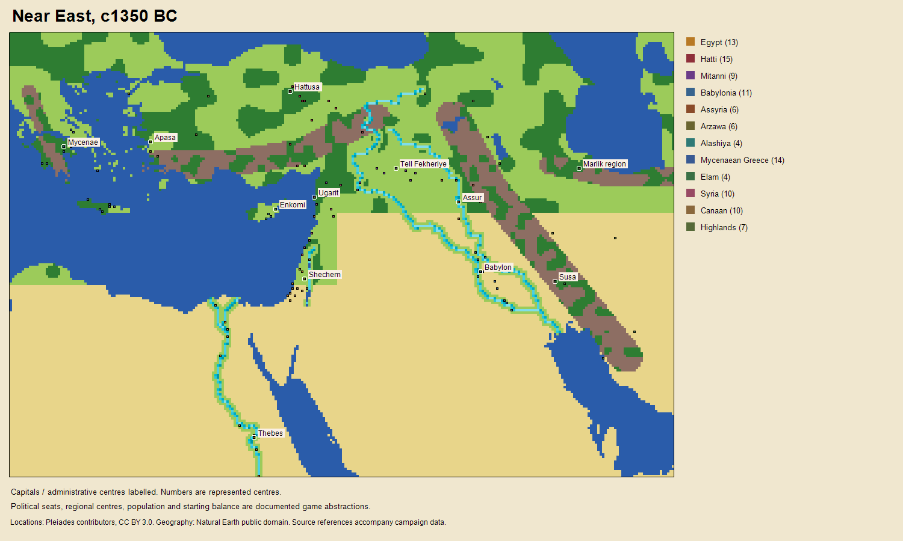
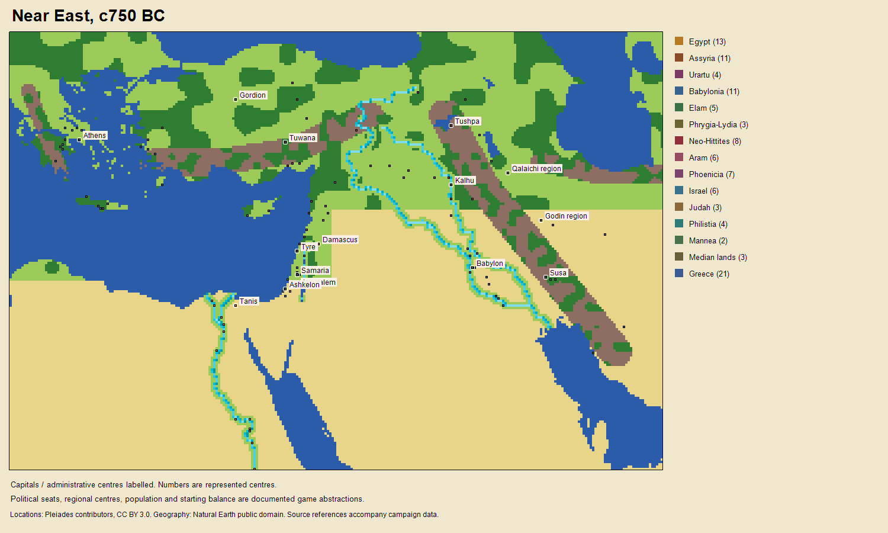

# Historical Near East campaigns for v0.9

Owner decisions, 2026-11-01: two historical openings around **1350 BC** and
**750 BC**, rather than a mixed-period empire collection. Reuse existing
mechanics first, with period-appropriate names and authored presentation.
Separate chariot combat is outside v0.9. Stronger Computer general is v0.10.
Delivery: [#1681](https://github.com/diegoami/imperial_conquest_2/issues/1681)
and [#1682](https://github.com/diegoami/imperial_conquest_2/issues/1682);
historical brief: [#1308](https://github.com/diegoami/imperial_conquest_2/issues/1308).

The two authored campaigns use this source and authoring contract. Individual
opening owners remain explicit gameplay compression rather than established
exact-year borders. Historical openings do not force subsequent turns to
reproduce history. The [authoring guide](../../tools/NearEast/README.md) records
the pinned public sources, attribution, reproducible build and limitations.

The owner additionally approved clearly labelled regional centres at dated
archaeological sites for poorly documented tribal regions (2026-11-01).
Their names, ownership and population are explicit game abstractions, separate
from the cited archaeological location/date evidence.

## c1350 BC: Late Bronze Age powers and palace states

Egypt, Hatti, Mitanni, Kassite Babylonia, Assyria, Arzawa and Alashiya belong in
the political framework. UCL's Amarna inventory identifies correspondence
between Egypt and the latter six powers, as well as dependent rulers in
Syria-Palestine. Letters establish a diplomatic network, not precise borders
or equal military strength. [UCL, Amarna correspondence](https://www.ucl.ac.uk/museums-static/digitalegypt/amarna/cuneiform2.html).

A British Museum tablet dated about 1350 BC identifies Tushratta of Mitanni
and Amenhotep III of Egypt. Its approximate dating must not be turned into
an exact accession chronology for every starting ruler.
[British Museum, EA 23](https://www.britishmuseum.org/collection/object/W_1888-1013-78).

The Aegean belongs to the Mycenaean setting. The Greek archaeological service
dates Mycenae's principal surviving Late Bronze Age monuments to 1350–1200 BC;
grouping several palace centres into one playable seat would be a game
abstraction, not evidence of a unified Greek state.
[Ephorate of Antiquities of Argolida](https://www.argolisculture.gr/en/list-of-monuments/acropolis-of-mycenae/).

Elam supplies the southeastern setting, with Susa and Anshan as important
centres. The archaeological account stresses geographic and political
complexity rather than a simple, permanently unified block.
[Elizabeth Carter, Elam archaeology](https://www.iranicaonline.org/articles/elam-ii/).

The authoring roster can use the following **designed seat groupings**. They
reserve space within the 16-nation budget; they do not establish exact 1350 BC
ownership or independence for each city:

| Seats | Historical foundation and authoring rule |
|---|---|
| Egypt, Hatti, Mitanni, Babylonia, Assyria, Arzawa, Alashiya | Amarna framework above; source opening capitals, rulers and city owners separately. |
| Mycenaean palace states | A grouped seat; no Classical Greek poleis or legendary king presented as measured history. |
| Elam | Source Susa/Anshan and the selected opening chronology separately. |
| Syrian and Canaanite city groupings | Amarna dependent rulers; one or more grouped seats are designed compression. Do not imply all were independent of Egypt or Mitanni. |
| Zagros communities, if needed for the final map | A regional grouping requires local site evidence; do not call it a Persian empire. |
| Barbarian arrivals | One non-playable gameplay faction; not a historical unified nation or a claim of a particular invasion in 1350 BC. |

No Achaemenid Persia, Seleucids or Ptolemies. There is room for additional
historically supported local seats without exceeding 15 regular seats plus
the barbarian role. A general cultural label alone does not justify a town,
its coordinates, its occupation at this date or its owner.

## c750 BC: Assyria, Urartu and smaller regional kingdoms

This opening uses the **Neo-Assyrian** setting and surviving Neo-Hittite
kingdoms, not the Bronze Age Hittite empire. ORACC's country overview identifies
Assyria's conflict with Urartu, southern Mesopotamian cities and tribes, and
Egypt/Kush in the eighth-century setting. These summaries cover a century;
later conquests must not be pre-applied to a 750 BC opening.
[ORACC, countries and peoples](https://oracc.museum.upenn.edu/saao/aebp/essentials/countries/index.html).

Tabal was politically fragmented. ORACC distinguishes its principalities,
Que/Hiyawa in Cilicia and Phrygia, whose capital was Gordion. Its account also
shows why the later Midas/Sargon story cannot simply be assigned to 750 BC.
[ORACC, Tabal and Phrygia](https://oracc.museum.upenn.edu/saao/aebp/Essentials/Countries/TabalandPhrygia/index.html).

The Iranian side can represent Mannea and Median communities. ORACC describes
Mannea in the Urmia basin and small Median city states in the Zagros. A single
Median seat is explicitly designed aggregation, not the later empire of
Cyaxares. [ORACC, Mannea](https://oracc2.museum.upenn.edu/saao/aebp/Essentials/Countries/Mannea/index.html),
[ORACC, the Medes](https://oracc.museum.upenn.edu/saao/aebp/Essentials/Countries/TheMedes/index.html).

Israel and Judah must be distinguished, with Samaria and Jerusalem as their
respective political centres; the Met's account places them in the setting of
Assyrian expansion. This alone does not establish each border town's owner.
[Metropolitan Museum, Cyrus and the Judean Diaspora](https://www.metmuseum.org/es/perspectives/cyrus-and-the-judean-diaspora).

Authored roster: Assyria, Urartu, Babylonia, Egypt, Elam, Phrygia/Lydia,
Neo-Hittite principalities (Tabal/Cilicia/Melid), Aramean principalities,
Phoenician cities, Israel, Judah, Philistia, Mannea, Median communities and
Aegean Greek communities, plus the barbarian role. These fifteen regular seats
fit the nation budget while keeping Philistia distinct from Judah. Grouped
principalities and coastal cities are **designed compression**, not unified
historical states. No later imperial borders, post-conquest Assyrian provinces
or Achaemenid Persian state are pre-applied to this opening.

## Authored openings and map inspection

`near-east-1350bc` has twelve regular seats and 109 centres;
`near-east-750bc` has fifteen and 107. Both add one non-playable barbarian role
and share a 276 × 185 geographic footprint. Each regular seat starts with one
army; seven fleets provide naval openings in each period. Setup quantities,
neutral regular-state relations and generic institutional leader titles are
explicitly designed. Both use the existing twenty-year campaign horizon.

## Reuse of mechanics

| Existing system | v0.9 application |
|---|---|
| Light/heavy infantry and archers | Period names and original-authored symbols; existing statistics, quality, recruitment, movement and combat behavior. |
| Two mobile troop archetypes | Explicit mobile/chariot proxies where appropriate. Existing move/attack behavior; no wheeled terrain, crew, charge or mounted-archery subsystem. Labels and help must state the abstraction. |
| Fleets and carried armies | Existing ships, transport capacity, sailing, landings and naval combat. No special Bronze Age naval engine. |
| Cities, loyalty, supply and money | Existing economy, supply consumption, capture and capital/conquest rules. Economic quantities and garrisons are designed balance values, not historical censuses. |
| Strategic and tactical AI | Existing policies appropriate to custom worlds; no classical Mediterranean coordinate table on a new map and no v0.10 general optimization. |
| Barbarians | The separately approved boundary-arrival mechanic, ordinary command execution and permanent hostility; source any period-specific identity used in presentation. |

Do not duplicate handlers to create a new era. A names/art mapping must not
quietly change numerical combat coefficients. Keep canonical unit IDs stable
within each new ruleset so save loading and AI type references resolve.

## Map, provenance and implementation acceptance

Use an authored Aegean–Anatolia–Levant–Mesopotamia–Zagros footprint, including
the Nile approach and sea approaches. The two periods may share coastline and
terrain while keeping distinct city lists, political ownership and openings.
The comparable Mediterranean scale is a design goal, not permission to reuse
the original game's map or pixels. Coastlines, relief, rivers and tile scale
must have a reproducible authoring script and compatible public source licence.
Do not add navigable links across land merely to connect separate seas.

Each committed town needs a stable ID, period name, dated occupation evidence,
coordinate source and a separately justified owner. Approximate locations and
uncertain identifications must be marked. Pleiades supplies reusable place
data under attribution terms, but representative points and broad period tags
do not prove exact occupation or allegiance in a particular year.
[Pleiades downloads](https://pleiades.stoa.org/downloads),
[Pleiades help](https://pleiades.stoa.org/help).

The data implementation must pin source revisions/downloads and licences,
retain attribution, record projection/tile placement, and label all invented
starting forces, treasuries, supply, population, ownership compression and
relations as designed. No source map art or screenshots are copied without a
compatible licence. Use generic ruler titles where a personal identification
has not been established, rather than silently inventing a historical king.

Before either delivery issue closes: load/resolve validation; nation budget;
unique city/force IDs; valid capital and seat references; in-bounds passable
placement; land/sea/cargo consistency; reachable approaches and embarkation;
new-game selection; native save/load; deterministic repeated seeds; and at
least the existing Italy campaign's 200-seat-turn acceptance with no rejected
commands or full-round stalls. Include barbarian cap/arrival/landing/capture
checks. Inspect rendered maps and actual new-game views, and state the limits
of automated checks. Existing campaign IDs and saved worlds must remain
resolvable. The brief does not replace the independent milestone review.
