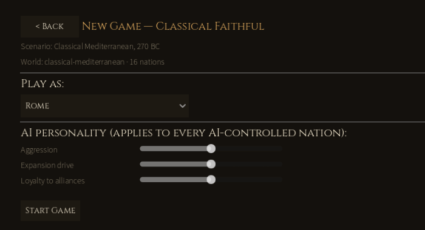
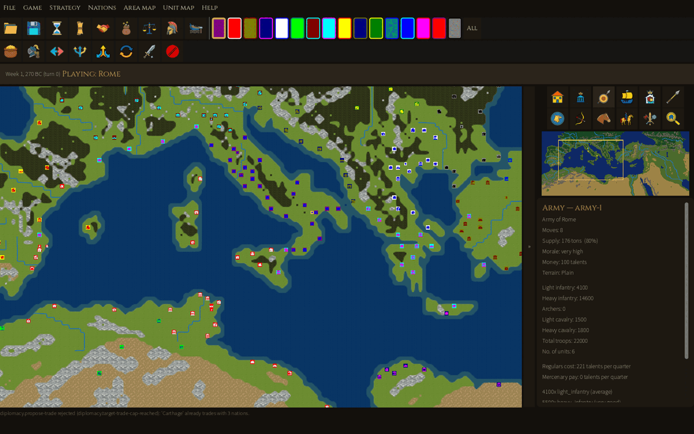
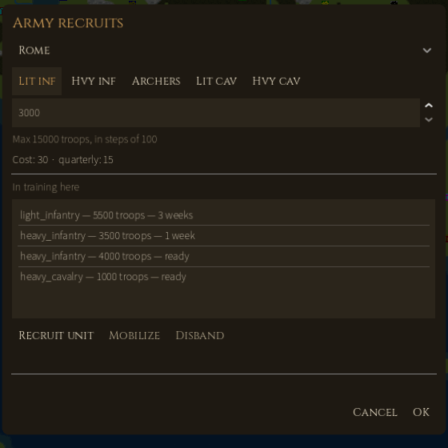
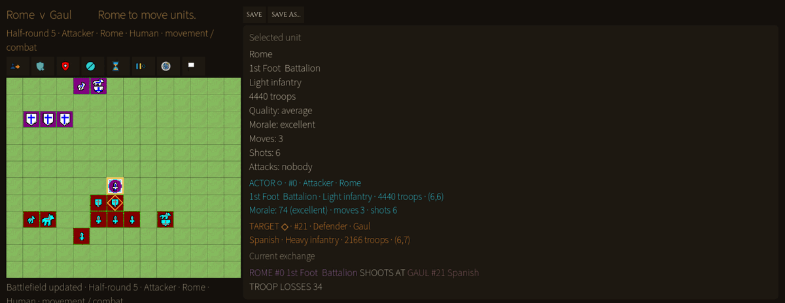
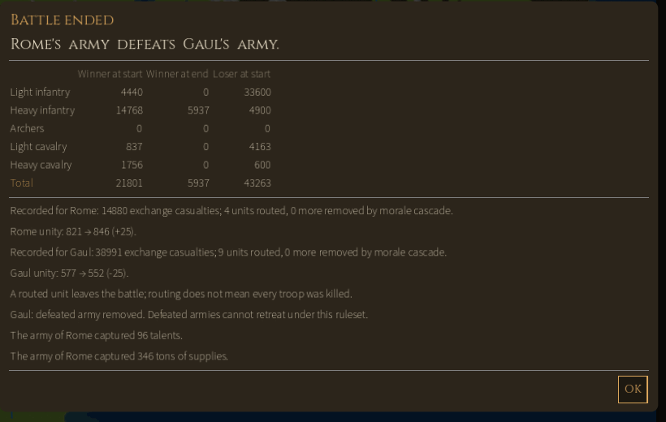
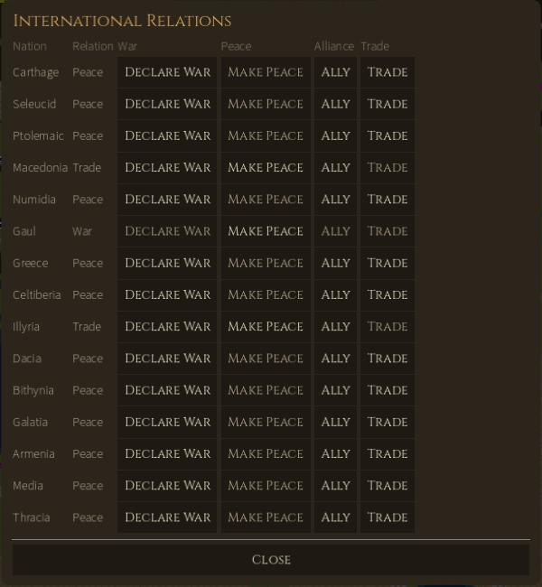

# Imperial Conquest 2 v0.6.2 — User Manual

2026-10-20 · tested on tag `v0.6.2` (commit `4253d8a`) · [#1280](https://github.com/diegoami/imperial_conquest_2/issues/1280)

How to install, start and play Imperial Conquest 2 v0.6.2 ("Readable battles and local diagnostics"), written from a real play session of the tagged build. The usability test is in [v062-usability-test.md](v062-usability-test.md).

## Getting started

v0.6.2 runs from source: you need the .NET 10 SDK and Godot 4.7.2 **.NET edition** (the standard Godot build cannot run C#). No files from the original 1996 game are needed; the game reads the shipped data under `data/`.

1. Install the .NET 10 SDK.
2. Download Godot 4.7.2 .NET: `Godot_v4.7.2-stable_mono_win64.zip` on Windows, `Godot_v4.7.2-stable_mono_linux_x86_64.zip` on Linux. Unzip it anywhere. On Windows use the `_console.exe`, which prints errors to the terminal.
3. Get the release: `git checkout v0.6.2`.
4. Build both projects from the repository root (the Godot project is not part of `IC2.sln`, so build it separately, and again after every pull):
   1. `dotnet build IC2.sln`
   2. `dotnet build godot/IC2.MapViewer.csproj`
5. First run only, import the assets: `godot --headless --path godot --import`
6. Start the game: `godot --path godot` (on Windows, the full path to the `_console.exe`).

Alternatively, open `godot/project.godot` in the Godot editor and press **Play** (F5); the editor compiles the C# itself.

**Packaged build.** `pwsh scripts/package.ps1` exports a self-contained Windows build to `rendered\export\ic2\`; start `game\IC2.MapViewer.exe` there. It needs neither Godot nor .NET on the playing machine, but building it needs the Godot 4.7.2 .NET export templates.

**Terminal version.** The same engine plays in a console: `dotnet run --project src/IC2.Cli -- --scenario classical-mediterranean --seat rome`. Type `help` for its commands. It is useful for long or scripted games.

## Starting a game

The main menu has **New Game**, **Load**, **Settings** and **Quit** (Quit exits at once, without asking). A new game takes two screens.

**1. Choose a ruleset.** Click a card, then **Continue**. Each card is tied to one scenario, the Mediterranean in 270 BC with 16 nations.

|  | Classical Faithful (default) | Improved |
| --- | --- | --- |
| Goal | Total conquest: hold every city on the map | Domination: hold every city of every nation you are at war with |
| A beaten army or fleet | Is destroyed | Survives at reduced strength and scatters |
| Human vs AI | The original's unequal seat rules | The same rules for every seat |
| Money | Each army and fleet has its own purse | One central treasury |
| Recruiting into debt | Allowed | Refused |
| Original bugs | Two known bugs reproduced | Fixed |

**2. Choose your nation and the AI.** Pick a nation under **Play as**: Rome, Carthage, Seleucid, Ptolemaic, Macedonia, Numidia, Gaul, Greece, Celtiberia, Illyria, Dacia, Bithynia, Galatia, Armenia, Media or Thracia. Every other nation is played by the computer. Three sliders set the AI personality for all of them:

- **Aggression**: how much stronger the AI must be before it attacks.
- **Expansion drive**: has no effect under Classical Faithful in v0.6.2.
- **Loyalty to alliances**: recorded but not used in v0.6.2.

Press **Start Game**. There is no choice of seed, difficulty or game length, and only one human player per new game.

## The game screen

The strategic screen is the map with everything you need around it. Below, Rome's army-1 is selected in central Italy.

| Area | Where | What it does |
| --- | --- | --- |
| Menu bar | Top line | File, Game, Strategy, Nations, Area map, Unit map, Help. |
| Main toolbar | Under the menus | Open, Save, **End turn** (hourglass), then the six Strategy screens: News, International relations, Taxation, Balance sheet, Recruit unit, Build fleet. Hover an icon for its name. |
| Nation swatches | Right of the toolbar | One coloured square per nation, plus **All**. Picks the nation the side panel and minimap describe. Purple is Rome. |
| Order strip | Second toolbar row, only while something of yours is selected | The orders for that army (7), fleet (6) or city (Fortify), and **Cancel selection**. The map moves down a little when it appears. |
| Top bar | Above the map | Date and turn ("Week 3, 270 BC (turn 1)"), the nation you play, and save messages. While units move after End turn it shows **Skip** and **Fast**. |
| Map | Centre | Cities are framed squares in the owner's colour with a glyph; armies are smaller squares. No names are shown on the map. |
| » / « | Thin bar right of the map | Hides or shows the side column (also **F12**). |
| Side-panel icons | Right column, top | Twelve buttons: Show cities, capital, armies, fleets, all; mercenaries by type (light/heavy infantry, archers, light/heavy cavalry, all); Find a city. They highlight on the **minimap**, not the main map. |
| Minimap | Under the icons | The whole world; the yellow box is your view. Click it to jump there. |
| Context panel | Right column, bottom | Details of what you clicked: nation overview, city, army or fleet. Information only; orders are in the menus and the order strip. |
| Status lines | Under the map | The outcome of your last order and of the computer's turns ("army-1 moved from (120,53) to (119,50), spending 3 of 8 moves."). Refusals appear here too. |
| News panel | Bottom, when opened | Strategy → News. Close it with **Dismiss**. |

## Playing a turn

A turn is two weeks. You give orders to your armies, fleets and cities in any order, then press **End turn**; the computer then plays every other nation, and you start the next turn.

**Find your forces.** Zoom in first: markers are only about 5 px wide at the opening zoom. Roll the mouse wheel over the area you want and drag with the left button to pan. **Area map → Find a city** (or the magnifier icon) centres the map on any city chosen by nation. **Show armies** marks your armies on the minimap.

**Select.** Left-click one of your markers. The context panel shows its details and the order strip shows what it can do. Right-clicking a city shows the mercenaries on offer there, without changing your selection.

**Move.** With an army selected, left-click any land tile. The army walks there in a straight line, paying the terrain's cost in moves:

| Terrain | Plain | Desert | Forest | Mountains | River | Calm sea | Rough sea |
| --- | --- | --- | --- | --- | --- | --- | --- |
| Moves per tile | 1 | 1 | 2 | 4 | 4 | 1 | 3 |

It stops short if it runs out of moves, or at any marker in its path, and stays selected while it has moves left. An army has 5–10 moves a turn: fewer when it is large, one fewer when its supply is below 10%. Fleets sail the same way on sea tiles.

> Careful: a left-click on empty ground always means "move". If you miss a marker you meant to select, the army you had selected marches there at once, and there is no undo. Clear the selection with **Esc** or **Shift+X** before clicking somewhere new.

**Attack.** Move next to the target (including diagonally) with at least one move left, then left-click it:

- army on an enemy army: a field battle (see Battles);
- army on an enemy city: a siege;
- fleet on an enemy fleet: a sea battle.

If you are not at war with the target, the game asks "Are you sure you want to attack… ?", and **Yes** declares war.

**Embark and land.** Click a selected army onto your own empty fleet next to it to board; select the fleet, sail, and click a land tile next to it to land.

**End the turn.** Press the hourglass or **Game → End turn**. If an army or fleet needs supplies, repairs or pay, an **End turn ?** box lists the problems: **Make more moves** returns to the map, **End turn** carries on. Then the computer's moves play on the map (**Skip** or **Fast** in the top bar), and reports open one at a time: battles you fought, other nations' battles, peace offers and diplomatic notices. Close each one to reach your next turn.

## Orders reference

Every order takes effect the moment you confirm it; Cancel in a dialog does not undo an order already given in it. If nothing suitable is selected, the game says "Select one of your armies/fleets/cities first."

**Strategy menu (nation-wide)**

| Order | What it does |
| --- | --- |
| News | Opens the news log at the bottom of the screen. |
| International relations | Declare war, make peace, ally or trade with each nation (see Diplomacy). |
| Taxation | Slider from 0% to 40%; shows the income now and at the new rate. Higher tax costs unity (see Rules). |
| Balance sheet | Revenue (taxes, tribute, trade), spending (administration, fleets, recruits, regulars, mercenaries), treasury ("Balance") and debt limit. |
| Recruit unit | Pick a city and a unit type, set the troops (from a fifth of a full battalion up to a full one, in steps of 100) and press **Recruit unit**. Training takes weeks; a finished unit shows "ready". Select it and press **Mobilize** to send it to a nearby army or form a new army beside the city. **Disband** cancels a slot (the money is lost). Only the capital, or a town with fortification of at least 75%, can take new recruits. |
| Build fleet | 10 to 100 ships at 10 talents each; the game picks the port ("The fleet will be built at Pisae"). Upkeep is 3 talents per ship per quarter; each ship carries 500 troops. |

**Army orders (Unit map → Army, or the order strip)**

| Order | What it does |
| --- | --- |
| Supply army | Take supply (10 t or 100 t at a time) from a city or fleet within one tile: free from your own, 1 talent per 5 t from a friendly foreign city. Also moves money between the army purse and the treasury or a fleet (purse cap 1,000). |
| Recruit mercenaries | Hire a mercenary unit offered at the city next to the army. Paid from the army's purse each quarter; unpaid mercenaries desert. Not possible above 20 units. |
| Transfer unit | Swap units, supply and money with your army on the next tile (the game picks the partner). |
| Split army | Move some units, supply and money into a new army on free land beside it (needs 2+ units). |
| Join armies | Merge with your army on the next tile. |
| Change units | Rename, split, join or disband individual units. |
| Disband army | Dissolve the army (asks first). |

**Fleet orders (Unit map → Fleet)**: Supply fleet; Repair fleet (only at one of your cities, uses its moves); Transfer ships; Split fleet; Join fleets; Scuttle fleet (asks first). None of the split, transfer or scuttle orders work while the fleet carries an army.

**City orders (Unit map → City)**: Fortify city adds fortification points, up to 10 a week; the cost is the population in thousands times the points. Not possible under siege.

## Battles

Sieges and sea battles resolve instantly. A field battle (army against army) with your nation on either side opens the tactical battle board, including when the computer attacks you.

**Sieges.** Your army's strength is set against the city's defence (loyalty, fortification and population); archers count triple. A **Battle Result** window gives both totals, casualties and the city's loyalty, fortification and population before and after. A failed siege still wears the city down: our first attack on Felsina fell short 20,720 to 34,050 but cut its fortification from 68% to 65%. Battle Result closes only with its **Close** button, not Esc.

**The tactical battle.** A 14 × 12 board. The defender places first, then the attacker; then the sides take turns (half-rounds), and melee is resolved at the end of the moving side's half-round.

1. **Place.** Click one of your units, then an empty cell in your zone: the attacker's first three rows or the defender's last three. Press the hourglass when done.
2. **Move.** Click a unit, then a cell. Wait for each move to finish before clicking again: clicks during the animation are ignored.
3. **Melee.** Click an enemy with your unit selected to set it as the target; the fight happens at the end of your half-round.
4. **Shoot.** Right-click an enemy within range: light infantry and light cavalry reach 1 cell, archers 2. Heavy infantry and heavy cavalry cannot shoot.
5. **End the half-round** with the hourglass.

The right-hand panel shows the selected unit (troops, quality, morale, moves, shots) and the current exchange, for example "ROME #0 1st Foot Battalion SHOOTS AT GAUL #21 Spanish — TROOP LOSSES 34". In the outline colours, cyan marks the unit acting, orange its target and gold your selection.

Toolbar, left to right: Unit moves, Friendly units, Enemy units, Cancel selection, **End turn** (half-round), Change pauses, **Computer general** (the computer fights your side; click the side panel to take back control), **Surrender**. Save and Save As sit above the panel.

The board cannot be closed: a battle ends when one side is routed or surrenders. A unit routs when its troops fall below a twenty-fifth of a battalion or its morale reaches 19.

**Battle ended.** The report compares each side by unit type at the start and end, then lists casualties, routed units, unity changes, captured talents and supplies, and the loser's fate. Under Classical Faithful the beaten army is removed. In our test the computer general won a fight at 1 to 2 odds: 21,801 Romans destroyed a Gaulish army of 43,263, finishing with 5,937 men.

## Diplomacy

**Strategy → International relations** lists every nation with your current relation (Peace, Trade, Alliance, War, or a cooldown) and four buttons. A greyed button is not available for that nation.

| Button | Available when | Effect |
| --- | --- | --- |
| Declare War | Not already at war | Immediate, **no confirmation**. War spreads one step: declaring on Thracia also put Rome at war with Thracia's ally Dacia. |
| Make Peace | At war, trading or allied | Proposes peace (ends a trade or alliance). The nation may refuse. |
| Ally | Not at war, not already allied | Proposes an alliance. The AI allies only against a common enemy. |
| Trade | Not at war, not already trading | Proposes trade. A nation trades with at most 3 partners. |

Answers appear only in the status lines under the map, for example "'Carthage' already trades with 3 nations" or "'Gaul' does not want to make peace at this time". Breaking a deal leaves a cooldown before relations can improve again (8 points after a broken trade, 24 after a broken alliance, 18 after a war), which thaws by about one point a season. Attacking a nation you are at peace with declares war automatically.

After a battle the loser may offer peace: an **Offer of peace** window with Yes and No. An unanswered offer lapses at your next End turn. A trade or alliance offered to you shows as "Pending offer from …" with **Accept Offer** in this dialog.

## Rules quick reference

**Calendar.** Each turn advances the week by 2 (weeks 1, 3, 5, 7, 9, 11), so there are 6 turns a season and 24 a year. The game starts in Week 1, Spring 270 BC and ends in 250 BC. Money is billed once a season ("per quarter").

**Units** (the same in both rulesets; recruit cost and upkeep are talents per 200 troops):

| Type | Board moves | Full battalion | Shots | Range | Recruit cost | Upkeep / quarter | Battle weight |
| --- | --- | --- | --- | --- | --- | --- | --- |
| Light infantry | 4 | 15,000 | 7 | 1 | 2 | 1 | 20 |
| Heavy infantry | 2 | 6,000 | 0 | – | 20 | 2 | 100 |
| Archers | 4 | 3,500 | 25 | 2 | 4 | 1 | 40 |
| Light cavalry | 6 | 7,000 | 9 | 1 | 15 | 3 | 60 |
| Heavy cavalry | 5 | 2,500 | 0 | – | 30 | 4 | 120 |

An army holds at most 20 units and 100,000 troops. Heavy units barely suffer from missiles; light infantry and archers suffer most.

**Economy.** Tax income = tax base × rate, with the rate from 0% to 40%. Each season the treasury pays regular units and ships (3 talents per ship); mercenaries are paid from their army's own purse. Unity changes each season by 25 − tax/2 − mobilization/5, within 300 to 990, so taxes above about 50 − mobilization/2.5 make it fall. Very low unity, or debt below the limit, can cost you your throne. The treasury may go down to −20,000.

**Supply.** An army can carry 1 ton per 100 troops and eats supply every turn (more in winter). Refill with Supply army next to your own city (free) or a friendly city (1 talent per 5 t). Below 10% supply, the army loses a move.

**Fleets.** Ships cost 10 talents, 10 to 100 per order, and carry 500 troops each. Storms damage fleets; a fleet whose condition drops below 40 sinks, so repair it in port.

## Winning and losing

You win by holding every one of the map's 334 cities (Classical Faithful), or every city of every nation you are at war with (Improved). Your reign ends early in any of these ways:

- **Time runs out** in 250 BC, twenty years after the start.
- **Your nation is conquered**: you lose your last city.
- **You are overthrown for unpopularity** when unity collapses.
- **You are deposed for not paying the army.**

When your game ends, the **End of Game** window says why ("Your nation has been conquerred by Greece" keeps the original's spelling), how many years you ruled, and your population, cities and treasury at the start and at the end. **Main menu** leaves; **View map** lets you look on, but no further orders are accepted.

A nation is not safe if you only sit tight. In a full test game where Rome gave no orders, both Roman armies were gone within two years. Rome kept 19–24 cities for a decade while 30,000 talents piled up unspent, then fell to 12 cities by 256 BC, briefly recovered to 18, and was conquered by Greece in Spring 253 BC.

## Saving, loading, settings and diagnostics

**Save.** The disk icon or **File → Save** writes to the file you loaded or last saved; a new game's first save is named `classical-mediterranean-turn-<N>.json`. **Save As** lets you pick a name ending in `.json`. The top bar confirms "Saved to …". There is **no autosave**, and leaving a game (File → New, Open or Close, or closing the window) does not offer to save, so save before you leave. You can also save in the middle of a tactical battle with its own Save buttons.

**Where files go** (the folder is named after the project, "Imperial Conquest 2 Map Viewer"):

| System | Folder |
| --- | --- |
| Windows | `%APPDATA%\Godot\app_userdata\Imperial Conquest 2 Map Viewer\` |
| Linux | `~/.local/share/godot/app_userdata/Imperial Conquest 2 Map Viewer/` |

Saves are in `saves/`, logs in `logs/`.

**Load.** Main menu → **Load** (or File → Open) lists the saves in the `saves` folder, newest first, as "file — scenario, turn N"; press **Continue** on one. **Browse…** opens any `.json` save, or a `.sav` from the original game (imported under Classical Faithful; it is never overwritten).

**Settings** (main menu). They last until you quit and are not stored:

- **Asset pack**: `authored` (default) or `placeholder` art; applies to the next game you start or load.
- **Sound**: on or off.
- **Battle pauses**: how long the tactical board waits after a shot (0–3 s, default 1) and after an attack (0–3 s, default 2). Lower them to speed up battles, especially with the computer general. The battle's own **Change pauses** button sets the same values.

**Diagnostics.** The game keeps a local journal of what happened: screens, commands, saves, battles and errors. It is in `logs/diagnostics/journal-*.jsonl` (five files of up to 1 MB each), with Godot's own log in `logs/godot.log`. Nothing is sent anywhere. If the game freezes or crashes, copy the whole `logs` folder **before** restarting it and attach it to your bug report.

## Mouse and keyboard reference

| Input | Strategic map | Tactical board |
| --- | --- | --- |
| Left click own marker | Select it | Select the unit |
| Left click empty tile | Move the selected army or fleet there | Place (setup) or move the selected unit |
| Left click adjacent enemy | Attack or besiege | Set it as the melee target |
| Right click | City: mercenaries on offer; army or fleet: its unit list | Enemy: shoot at it; own unit: clear its target |
| Mouse wheel | Zoom in or out at the cursor | – |
| Left drag | Pan the map | – |
| Click the minimap | Jump there | – |
| Esc | Clear the selection; skip the movement replay; close most dialogs or answer No | – (the board has no Esc) |
| Shift+X | Cancel selection | – |
| F12 | Hide or show the side column | – |
| Page Up / Page Down | Taxation ±5%; Recruit unit ±1,000 troops; Build fleet ±10 ships | – |

The Battle Result window does not close with Esc; use its Close button. Help → Show hints turns all tooltips on or off.

## Known limitations in v0.6.2

- One human player per new game. Hotseat play works only from a save that already has several human nations (made with the CLI).
- No choice of scenario, map, seed, difficulty or game length; the two smaller scenarios are reachable only from the CLI.
- Two of the three AI sliders have no effect under Classical Faithful; the Improved ruleset's 150-turn score limit is not checked.
- Field battles involving you are always fought on the tactical board; there is no "resolve instantly" option.
- Join and Transfer use the neighbouring army the game picks; you cannot choose.
- No names or tooltips on the map, no autosave, and settings are forgotten when you quit.
- Some original spellings are kept on purpose: "conquerred", "suuplies", "End turn ?".
- The graphics hang reported before this release (issue #1261) is not confirmed fixed; v0.6.2 adds the diagnostics journal to catch it.
- [v062-usability-test.md](v062-usability-test.md) lists the problems found while playing.
